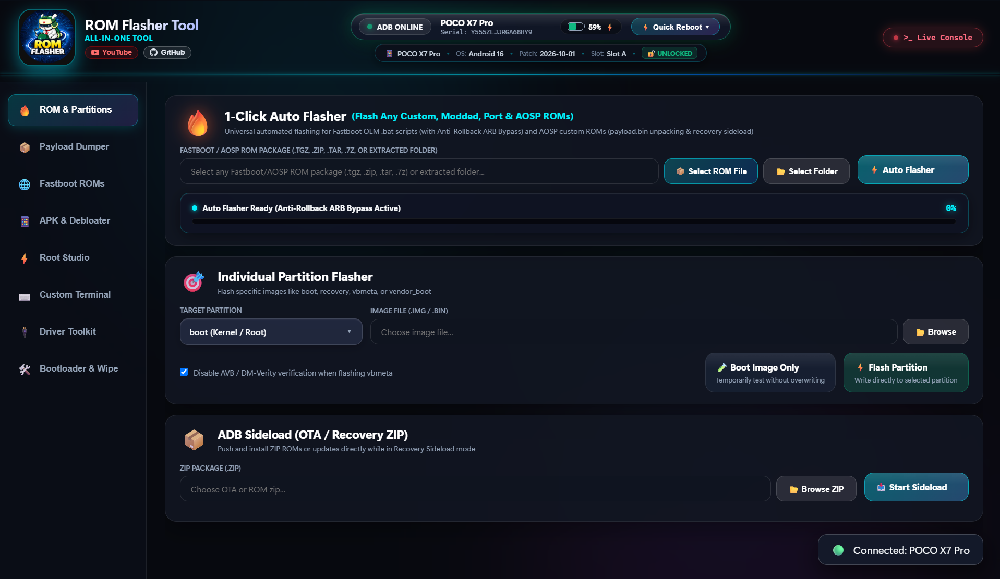
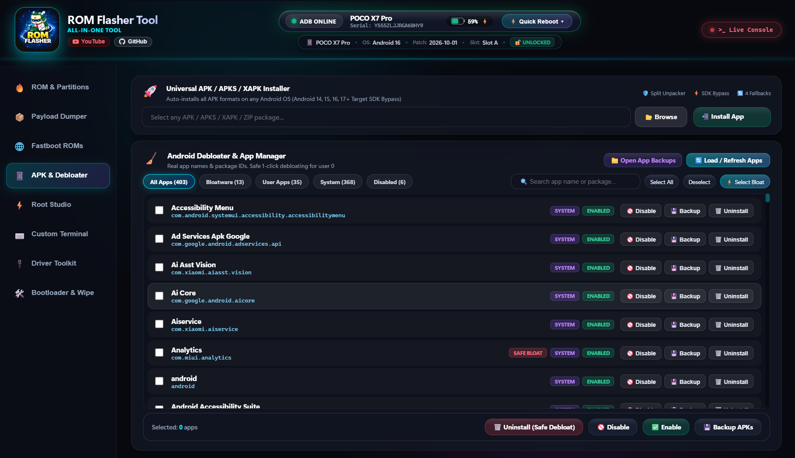
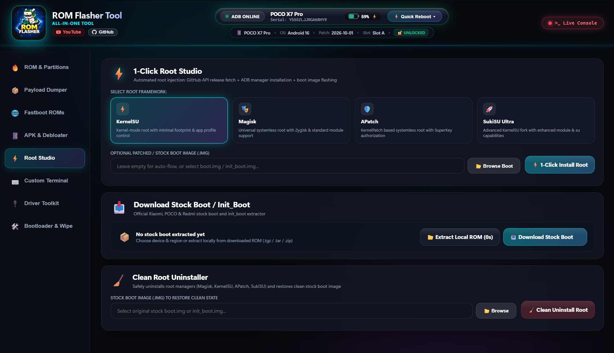

# ⚡ ROM Flasher Tool for PC (Windows)
### *The Ultimate Android Flashing, Debloating, Rooting & Recovery Suite with Apple Liquid Glass UI*

  <b>1-Click Fastboot Flasher</b> • <b>Anti-Rollback (ARB) Bypass</b> • <b>Payload Dumper Studio</b> • <b>Official Firmware Hub</b> • <b>Debloater & OBB Backup</b> • <b>Root Studio</b>

[📥 Download Latest .EXE](https://github.com/Rohit-Bhai-Youtube/ROM_Flasher_Tool_For_PC/releases/latest) • [📱 Phone-to-Phone Version (No PC)](https://github.com/Rohit-Bhai-Youtube/rom-flasher-tool) • [📺 YouTube Channel (@RohitBhai)](https://youtube.com/@RohitBhai)

---

## 📱 PC नहीं है? कोई बात नहीं! फोन से भी फ्लैश कर सकते हैं! (No PC? Use Phone-to-Phone OTG!)

> **💡 अगर आपके पास PC या Laptop नहीं है, तो भी चिंता की कोई बात नहीं है! आप सीधे अपने एक Android फोन से दूसरे फोन को USB-OTG केबल लगाकर पूरा ROM, Recovery और Root फ्लैश कर सकते हैं!**

मैंने इसी ROM Flasher Tool का एक **Android App Version** भी बनाया है, जो बिना किसी कंप्यूटर और बिना किसी Termux के सीधे मोबाइल से काम करता है:

👉 **[📱 Download ROM Flasher Tool for Android (No PC / USB-OTG Version)](https://github.com/Rohit-Bhai-Youtube/rom-flasher-tool)**

* **सुविधाएँ:** Phone-to-Phone USB OTG Fastboot Flashing, EFS/IMEI Backup, Stock ROM Downloader, Debloater, और 1-Click Rooting.

---

## 📸 Screenshots & Detailed Feature Walkthrough

---

### 1. ⚡ 1-Click Auto Flasher & Real-Time Apple HUD (`ROM & Partitions`)
* **Real-Time Apple Glass HUD:** सबसे ऊपर फोन का रियल-टाइम स्टेटस दिखता है—Device Model (`POCO X7 Pro`), Serial, Battery Level (`59% ⚡`), Active Slot (`Slot A`), Android Version (`Android 16`), Security Patch, Bootloader Status (`UNLOCKED`), और 1-Click Quick Reboot मेनू।
* **1-Click Auto Flasher:** किसी भी Fastboot ROM (`.tgz`, `.zip`, `.tar`, `.7z`) या फोल्डर को सेलेक्ट करते ही यह अपने-आप आर्काइव डिटेक्ट करता है और **Anti-Rollback (ARB) Bypass** लगाकर फ्लैशिंग शुरू कर देता है, जिससे फोन हार्ड-ब्रिक होने से बचता है।
* **Individual Partition Flasher:** Apple Liquid Glass ड्रॉपडाउन से किसी भी ख़ास पार्टिशन (`boot`, `init_boot`, `recovery`, `vbmeta`, `vendor_boot`, `super`) को चुनकर कस्टम इमेज सीधे फ्लैश या टेस्ट बूट (`Boot Image Only`) कर सकते हैं।
* **ADB Sideload:** रिकवरी मोड में सीधे OTA या ROM zip पैकेज साइडलोड करने की सुविधा।

  

---

### 2. 📦 Payload Dumper Studio (`AOSP & Recovery ROMs`)
* **Lightning-Fast Extraction:** किसी भी AOSP या Custom ROM (जैसे PixelOS, LineageOS, EvolutionX) की ZIP या `payload.bin` को लोड करके कुछ ही सेकंड्स में उसकी सभी पार्टिशन इमेजेस को एनालाइज़ और एक्सट्रैक्ट करें।
* **Smart Quick-Filters:** 
  * `Core Boot` बटन दबाते ही सिर्फ रूटिंग और बूटिंग के लिए ज़रूरी पार्टिशन्स (`boot.img`, `init_boot.img`, `vendor_boot.img`, `vbmeta.img`, `dtbo.img`) एक क्लिक में सेलेक्ट हो जाते हैं।
  * `System & Vendor` बटन से सिस्टम पार्टिशन्स को सेलेक्ट कर सकते हैं।
* **Selected Size & Multi-Extraction:** स्क्रीन पर साफ़ दिखता है कि कितने पार्टिशन्स सेलेक्ट हुए हैं और उनका कुल साइज़ कितना है (`Selected: 6 partitions (136.0 MB)`).

  

---

### 3. 🌐 Xiaomi, POCO & Redmi Official ROM Downloader (`Fastboot ROMs`)
* **Direct High-Speed Official CDN Downloads:** Xiaomi के 370+ डिवाइसेस के लिए ऑफिशियल Fastboot (`.tgz`) और Recovery (`.zip`) ROMs सीधे हाई-स्पीड सर्वर से डाउनलोड करें।
* **Region Filter Pills:** All Regions, India (IN), Global (MI), Europe (EEA), China (CN), Indonesia (ID), Russia (RU), Turkey (TR), Taiwan (TW) के लिए 1-क्लिक रीजन फिल्टर्स।
* **Accurate Android Badges:** हर वर्ज़न के साथ उसका सटीक Android वर्ज़न (जैसे `ANDROID 16`, `ANDROID 15`) और रिलीज डेट दिखती है।
* **Direct Actions:** `⚡ Fast Download (.tgz)`, `🌐 Browser / IDM` (लिंक को IDM या ब्राउज़र में खोलने के लिए), और `📥 Boot Only` (पूरी 8-10 GB ROM डाउनलोड किए बिना सिर्फ `boot.img` और `init_boot.img` एक्सट्रैक्ट करने के लिए)।

  

---

### 4. 🛡️ Universal APK Installer, Debloater & Game OBB Backup Engine (`APK & Debloater`)
* **Universal APK / APKS / XAPK Installer:** किसी भी सिंगल APK, Split APKs, या XAPK बंडल को Android 14/15/16 टारगेट SDK लिमिटेशंस को बाईपास करके 1-क्लिक में इंस्टॉल करें।
* **Android Debloater & App Manager:**
  * फोन के सभी 400+ ऐप्स को सिस्टम, यूजर और सेफ ब्लोटवेयर में ऑटो-कैटेगराइज़ करता है।
  * **Xiaomi HyperOS / MIUI Security Bypass:** बिना किसी सिम कार्ड या MIUI Security Settings की पाबंदी के ब्लोटवेयर को सेफली User 0 के लिए फ्रीज़/अनइंस्टॉल करता है।
  * **Per-App Inline Action Buttons:** हर ऐप के आगे डायरेक्ट `🚫 Disable`, `✅ Enable`, `💾 Backup`, और `🗑️ Uninstall` बटन उपलब्ध हैं।
* **Full Game & OBB Backup:** गेम का बैकअप लेते समय न सिर्फ Split APKs बल्कि पूरा Game OBB फोल्डर (`/sdcard/Android/obb/<pkg>`), मीडिया डेटा, और 1-क्लिक ऑटो-रिस्टोर स्क्रिप्ट (`Restore_App_And_Data.bat`) डेस्कटॉप स्टोरेज फ़ोल्डर में ऑटोमैटिकली सेव हो जाती है।

  

---

### 5. 🧪 1-Click Root Studio & Boot Extractor (`Root Studio`)
* **Multi-Framework Root Injection:**
  * **KernelSU:** कर्नल-मोड रूटिंग (मिनिमल फुटप्रिंट और बेहतरीन प्राइवेसी)।
  * **Magisk:** यूनिवर्सल सिस्टमलेस रूट विथ Zygisk और मॉड्यूल सपोर्ट।
  * **APatch:** KernelPatch बेस्ड सिस्टमलेस रूट विथ SuperKey ऑथराइजेशन।
  * **SukiSU Ultra:** एडवांस्ड KernelSU फोर्क विथ एन्हांस्ड मॉड्यूल कैपेबिलिटी।
* **1-Click Install Root:** खाली इमेज देने पर ऑटोमैटिकली डिवाइस से बूट इमेज फेच करके पैच और फ्लैश करता है।
* **Download Stock Boot:** 1-क्लिक में बिना पूरी ROM डाउनलोड किए फोन का ऑफिशियल स्टॉक `boot.img` निकालें।
* **Clean Root Uninstaller:** 1-क्लिक में रूट पूरी तरह अनइंस्टॉल करके डिवाइस को क्लीन स्टॉक स्टेट में रीस्टोर करता है।

  

---

## 📥 Standalone Executable (.EXE) डाउनलोड करें

किसी इंस्टॉलेशन की ज़रूरत नहीं है। सीधे डाउनलोड करें और Windows 10 या 11 पर रन करें:

👉 **[⬇️ Download Latest ROM Flasher Tool for PC (.exe)](https://github.com/Rohit-Bhai-Youtube/ROM_Flasher_Tool_For_PC/releases/latest)**

---

## 📺 Follow Rohit Bhai on YouTube!

नए कस्टम रोम्स, रूटिंग गाइड्स, अनब्रिकिंग ट्यूटोरियल्स और स्टेप-बाय-स्टेप वीडियो देखने के लिए चैनल को ज़रूर सब्सक्राइब करें:

* **📺 YouTube Channel:** [Rohit Bhai (@RohitBhai)](https://youtube.com/@RohitBhai)
* **🌐 Official Website:** [romflasher.in](https://romflasher.in) — *180+ स्टेप-बाय-स्टेप फ्लैशिंग गाइड्स, रिकवरी और कस्टम रोम्स.*
* **📱 Android-to-Android Flasher:** [ROM Flasher Tool for Android (No PC / USB-OTG)](https://github.com/Rohit-Bhai-Youtube/rom-flasher-tool)

---

## ⚖️ License & Credits

This tool is created for educational, recovery, and development purposes.  
Developed with ❤️ by **Rohit Bhai**.
