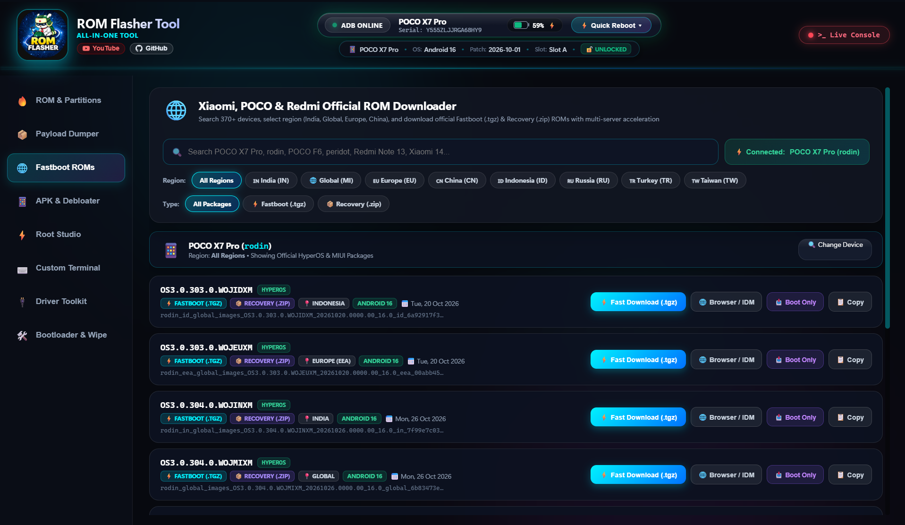

# ⚡ ROM Flasher Tool for PC (Windows) — v2.0.0
### *The Ultimate Android Flashing, Wireless ADB, Mi Unlock, Rooting, EFS & EDL/BROM Unbrick Suite with Apple Liquid Glass UI*

  <b>1-Click Fastboot & ARB Bypass</b> • <b>Wireless ADB (QR & Auto-Discover)</b> • <b>Smart Mi Account Unlock</b> • <b>KernelSU / Magisk / APatch / SukiSU Ultra</b> • <b>EDL 9008 & MTK BROM Unbrick</b> • <b>Structured IMEI/EFS Studio</b>

[📥 **Download Latest v2.0.0 .EXE**](https://github.com/Rohit-Bhai-Youtube/ROM_Flasher_Tool_For_PC/releases/latest) • [📱 **No PC? Android-to-Android Version**](https://github.com/Rohit-Bhai-Youtube/rom-flasher-tool) • [📺 **YouTube (@Rom_Flasher)**](https://www.youtube.com/@Rom_Flasher) • [🌐 **Guides (romflasher.in)**](https://romflasher.in)

---

> ⭐ **Like this project? Give it a Star!** It helps more Android developers, modders, and technicians discover this free all-in-one toolkit.

---

## 📱 Don't Have a PC? Flash Phone-to-Phone over USB-OTG!

> **💡 No PC or laptop? No problem!** You can flash Fastboot ROMs, custom recoveries, root, and backup EFS directly from **one Android phone to another** using a USB-OTG cable — **No PC, No Termux, No Host Root Required!**

👉 **[📱 Download ROM Flasher Tool for Android (No PC / USB-OTG)](https://github.com/Rohit-Bhai-Youtube/rom-flasher-tool)**

* **Android App Features:** Android-to-Android USB-OTG Fastboot flashing, native Rust `payload.bin` dumper, stock ROM downloader, EFS/IMEI backup, debloater, Play Integrity bypass, and 1-click root.

---

## 🔥 What's New in v2.0.0

| Module | What's Upgraded in v2.0.0 |
| :--- | :--- |
| **📶 Wireless ADB (Main Screen)** | Direct **Wireless ADB** pill next to Dynamic Island! Core UDP `5353` mDNS auto-discovery shows all nearby Wi-Fi phones by real name, plus **QR Code Pairing**, **6-digit Pairing Code**, **1-Click USB → Wi-Fi**, and saved IP history. |
| **🔐 Smart Bootloader Unlock** | Auto-detects **Pixel/Nothing/OnePlus** (standard Fastboot unlock) vs **Xiaomi/POCO/Redmi** (opens integrated **Mi Account Login & Unlock** popup with server `encryptData` token). |
| **🧪 1-Click Root Studio (Android 10–17)** | Full live-verified support for **KernelSU**, **Magisk**, **APatch**, & **SukiSU Ultra** (`ksud` + GKI `init_boot` / `boot` smart routing, spoofed bootloader lock bypass, & clean stock uninstaller). |
| **🛡️ Structured IMEI & EFS Studio** | Instant pre-flight root verification, auto-detects **Device + Android Version + ROM** (`HyperOS 1–4`, `Infinity-X`, `ColorOS Port`, `crDroid`, etc.), **Rooted ADB `dd` restore** (bypasses MediaTek Fastboot Protected Partitions!), and **1-Click Synced Backup Picker Popup**. |
| **💀 EDL 9008 & MTK BROM Unbrick** | Auto-scans Factory Unbrick ROM folders (`Firehose`, `rawprogram*.xml`, `patch*.xml`, `Scatter`, `DA`, `Auth`) and flashes hard-bricked Qualcomm & MediaTek devices over emergency COM ports. |
| **📥 7.4s Stock Boot Extractor** | Prioritizes Aliyun Singapore OSS CDN + 256 KB chunked HTTP Range streaming to extract `boot.img` & `init_boot.img` in **~7 seconds** without downloading the full 6–8 GB ROM. |
| **📊 Live Sideload % & Stability** | Real-time `adb sideload` `%` streaming, multi-device `-s <serial>` isolation, silent background subprocesses, and Apple Liquid Glass dropdowns across the entire UI. |

---

## 📸 Screenshots & Feature Walkthrough

### 1. ⚡ 1-Click Auto Flasher, Wireless ADB & Apple Glass HUD (`ROM & Partitions`)
* **Real-Time Apple Glass HUD:** Displays live device diagnostics — Device Name, Codename, Serial, Battery Level, Active Slot (`Slot A/B`), Android Version, Security Patch, Bootloader Lock Status, Quick Reboot, and **📶 Wireless ADB** right beside the Dynamic Island.
* **1-Click Auto Flasher:** Supports Fastboot ROM archives (`.tgz`, `.zip`, `.tar`, `.7z`) and extracted folders with **Anti-Rollback (ARB) Bypass** and **BrickShield** codename protection.
* **Individual Partition Flasher & Live ADB Sideload:** Apple Liquid Glass selector for `boot`, `init_boot`, `recovery`, `vbmeta` (AVB disable), `vendor_boot`, `super`, plus live `%` `adb sideload` streaming.

  

---

### 2. 📦 Payload Dumper Studio (`AOSP & Recovery ROMs`)
* **High-Speed Partition Extraction:** Inspect and extract raw partition images directly from AOSP/Custom ROM zip archives (`PixelOS`, `LineageOS`, `Evolution X`, `HyperOS`) containing `payload.bin`.
* **Smart Quick-Filters:** 1-click **Core Boot** (`boot.img`, `init_boot.img`, `vendor_boot.img`, `vbmeta.img`, `dtbo.img`) or **System & Vendor** batch extraction with exact size readout.

  

---

### 3. 🌐 Xiaomi, POCO & Redmi Official ROM Downloader (`Fastboot ROMs`)
* **370+ Devices Supported:** Instant search across Xiaomi, Redmi, and POCO models for official Fastboot (`.tgz`) and Recovery (`.zip`) ROMs.
* **Region Filters:** `ALL`, `India (IN)`, `Global (MI)`, `Europe (EEA)`, `China (CN)`, `Indonesia (ID)`, `Russia (RU)`, `Turkey (TR)`, `Taiwan (TW)`.
* **7.4s Boot Extractor:** `📥 Boot Only` pulls `boot.img` & `init_boot.img` directly via HTTP Range requests without downloading the full ROM.

  

---

### 4. 🛡️ Universal APK Installer, Debloater & Game OBB Backup (`APK & Debloater`)
* **Universal Package Installer:** Installs `.apk`, `.apks` (Split APKs), and `.xapk`, bypassing Android 14/15/16/17 target SDK blocks.
* **HyperOS / MIUI Safe Debloater:** Categorizes 400+ packages with User 0 safe disable/uninstall even under Xiaomi USB security restrictions.
* **Complete Game OBB Backup:** Backs up Split APKs + `/sdcard/Android/obb/<pkg>/` + Media with auto-generated `Restore_App_And_Data.bat`.

  

---

### 5. 🧪 1-Click Root Studio (`KernelSU`, `Magisk`, `APatch`, `SukiSU Ultra`)
* **All 4 Major Root Frameworks:** Smart Android 10–17 GKI routing (`init_boot.img` for KernelSU/Magisk/SukiSU Ultra, `boot.img` for APatch & Legacy Android 10–12).
* **Clean Root Uninstaller:** Removes all root manager APKs and restores clean stock `boot.img` / `init_boot.img` in 1 click.

  

---

## 📥 Download Standalone Executable (.EXE)

1. Download **`ROM_Flasher_Tool.exe`** from **[Latest Releases](https://github.com/Rohit-Bhai-Youtube/ROM_Flasher_Tool_For_PC/releases/latest)**.
2. Run directly on **Windows 10 / Windows 11 (64-bit)** — no Python installation required.
3. Built-in **1-Click Auto-Updater** notifies you whenever a newer release drops.

---

  <b>Built with ❤️ by <a href="https://www.youtube.com/@Rom_Flasher">Rohit Bhai (@Rom_Flasher)</a></b> 
  If this tool saved your phone or time, please ⭐ Star this repository!

