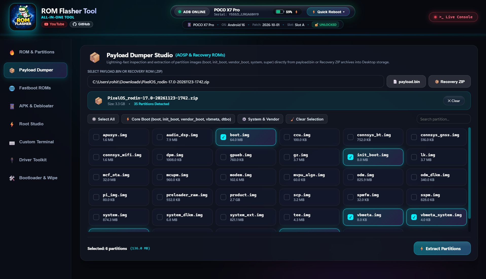

# ⚡ ROM Flasher Tool for PC (Windows)
### *The Ultimate Android Flashing, Debloating, Rooting & Recovery Suite with Apple Liquid Glass UI*

  <b>1-Click Fastboot Flasher</b> • <b>Anti-Rollback (ARB) Bypass</b> • <b>Payload Dumper Studio</b> • <b>Official Firmware Hub</b> • <b>Universal Debloater & OBB Backup</b> • <b>Root Studio</b>

[📥 Download Latest .EXE](https://github.com/Rohit-Bhai-Youtube/ROM_Flasher_Tool_For_PC/releases/latest) • [📱 Phone-to-Phone Version (No PC)](https://github.com/Rohit-Bhai-Youtube/rom-flasher-tool) • [📺 YouTube Channel (@RohitBhai)](https://youtube.com/@RohitBhai)

---

## 📱 Don't Have a PC? Flash Phone-to-Phone over USB-OTG!

> **💡 No PC or laptop? No problem! You can flash Fastboot ROMs, custom recoveries, and root directly from one Android phone to another using a USB-OTG cable!**

An official **Android App Version** of ROM Flasher Tool is available that operates completely standalone without needing a computer or Termux:

👉 **[📱 Download ROM Flasher Tool for Android (No PC / USB-OTG)](https://github.com/Rohit-Bhai-Youtube/rom-flasher-tool)**

* **Features:** Android-to-Android USB OTG Fastboot flashing, EFS/IMEI backup & restore, stock ROM downloader, debloater, and 1-click rooting.

---

## 📸 Screenshots & Feature Walkthrough

---

### 1. ⚡ 1-Click Auto Flasher & Real-Time Apple HUD (`ROM & Partitions`)
* **Real-Time Apple Glass HUD:** Displays live device diagnostics at the top bar—Device Codename (`POCO X7 Pro`), Serial number, Battery Level (`59% ⚡`), Active Slot (`Slot A`), Android Version (`Android 16`), Security Patch Level, Bootloader Lock Status (`UNLOCKED`), and Quick Reboot options.
* **1-Click Auto Flasher:** Supports Fastboot ROM archives (`.tgz`, `.zip`, `.tar`, `.7z`) and extracted folders. Automatically applies **Anti-Rollback (ARB) Bypass** to prevent downgrade bricking.
* **Individual Partition Flasher:** Apple Liquid Glass selector to directly flash individual partitions (`boot`, `init_boot`, `recovery`, `vbmeta` with AVB disable, `vendor_boot`, `super`) or test images safely with `Boot Image Only`.
* **ADB Sideload:** Push and install OTA update zip files directly in Recovery Sideload mode.

  

---

### 2. 📦 Payload Dumper Studio (`AOSP & Recovery ROMs`)
* **High-Speed Partition Extraction:** Inspect and extract raw partition images directly from AOSP/Custom ROM zip archives (PixelOS, LineageOS, EvolutionX) containing `payload.bin`.
* **Smart Quick-Filters:**
  * **Core Boot:** Automatically selects essential partitions needed for rooting and recovery (`boot.img`, `init_boot.img`, `vendor_boot.img`, `vbmeta.img`, `dtbo.img`).
  * **System & Vendor:** Quickly selects large OS partitions.
* **Batch Extraction:** Select specific partitions or extract everything at once with real-time size computation (`Selected: 6 partitions (136.0 MB)`).

  

---

### 3. 🌐 Xiaomi, POCO & Redmi Official ROM Downloader (`Fastboot ROMs`)
* **Official High-Speed CDN Downloads:** Instant search across 370+ Xiaomi, Redmi, and POCO devices to download official Fastboot (`.tgz`) and Recovery (`.zip`) packages directly from official CDN servers.
* **Region Filtering Pills:** Quick toggle filters for All Regions, India (IN), Global (MI), Europe (EEA), China (CN), Indonesia (ID), Russia (RU), Turkey (TR), and Taiwan (TW).
* **Accurate Android Badges:** Correctly resolves base Android versions (`ANDROID 16`, `ANDROID 15`) and release dates.
* **Direct Actions:** `⚡ Fast Download (.tgz)`, `🌐 Browser / IDM` (opens CDN direct links in IDM or web browser), and `📥 Boot Only` (extracts `boot.img` and `init_boot.img` without downloading the full 10GB archive).

  

---

### 4. 🛡️ Universal APK Installer, Debloater & Game OBB Backup (`APK & Debloater`)
* **Universal Package Installer:** Installs standard APK, split APK (APKS), and XAPK packages, bypassing Android 14/15/16 target SDK installation blocks.
* **Universal Android Debloater:**
  * Categorizes 400+ installed packages into System Apps, User Apps, Safe Bloatware, and Disabled Apps.
  * **HyperOS / MIUI Bypass:** Freezes and uninstalls bloatware safely for User 0 even when Xiaomi USB debugging security restrictions are active.
  * **Inline Action Buttons:** Direct per-app buttons: `🚫 Disable`, `✅ Enable`, `💾 Backup`, and `🗑️ Uninstall`.
* **Complete Game OBB Backup Engine:** Backs up Split APKs, full Game OBB directories (`/sdcard/Android/obb/<pkg>/`), and Media storage. Auto-generates a 1-click `Restore_App_And_Data.bat` script inside each backup folder for effortless offline reinstallation.

  

---

### 5. 🧪 1-Click Root Studio & Boot Extractor (`Root Studio`)
* **Multi-Framework Root Injection:**
  * **KernelSU:** Kernel-level root with minimal system footprint and per-app su control.
  * **Magisk:** Universal systemless root with full Zygisk and module support.
  * **APatch:** KernelPatch-based systemless root with SuperKey authorization.
  * **SukiSU Ultra:** Enhanced KernelSU fork with advanced module support.
* **1-Click Auto Root:** Automatically patches stock boot images and flashes them via Fastboot.
* **Download Stock Boot:** Pulls official stock `boot.img` for your exact model without downloading the entire ROM.
* **Clean Root Uninstaller:** Restores pure stock boot images in 1 click to completely unroot the device.

  

---

## 🚀 Complete Feature Overview

* **🍏 Apple Liquid Glass Dark UI:** Modern, ultra-responsive frosted glass theme with real-time HUD device diagnostics.
* **⚡ 1-Click Auto Flasher:** Built-in Anti-Rollback (ARB) bypass, BrickShield codename validation, and live fastboot log terminal.
* **🎯 Partition Flasher:** Flashes `boot`, `init_boot`, `recovery` (TWRP/OrangeFox), `vbmeta` (with disable AVB/DM-Verity), `vendor_boot`, `dtbo`, and `super`.
* **🛡️ Universal Debloater:** Safe User 0 debloating with Xiaomi HyperOS/MIUI SecurityException bypass.
* **💾 Full App & Game Backup:** Captures Split APKs, complete Game OBB data, and Media storage with automatic 1-click restore batch scripts.
* **📥 Official Firmware Hub:** Fast direct CDN downloads for 370+ Xiaomi/POCO/Redmi devices.
* **🧪 Root Studio:** Integrated Magisk, KernelSU, APatch, and SukiSU Ultra root injection.
* **🔌 Driver Assistant:** Universal WinUSB, Google Android Bootloader, MTK, and Qualcomm 9008 driver assistant.

---

## 📥 Download Standalone Executable (.EXE)

No installation required. Download the pre-built `.exe` file and run directly on Windows 10 or Windows 11:

👉 **[⬇️ Download Latest ROM Flasher Tool for PC (.exe)](https://github.com/Rohit-Bhai-Youtube/ROM_Flasher_Tool_For_PC/releases/latest)**

---

## 📺 Follow Rohit Bhai on YouTube!

Subscribe to the official YouTube channel for custom ROM reviews, rooting guides, device unbricking walkthroughs, and step-by-step tutorials:

* **📺 YouTube Channel:** [Rohit Bhai (@RohitBhai)](https://youtube.com/@RohitBhai)
* **🌐 Official Website:** [romflasher.in](https://romflasher.in) — *180+ detailed flashing guides, custom recoveries, and tutorials.*
* **📱 Android-to-Android Flasher:** [ROM Flasher Tool for Android (No PC / USB-OTG)](https://github.com/Rohit-Bhai-Youtube/rom-flasher-tool)

---

## ⚖️ License & Credits

This tool is created for educational, recovery, and development purposes. Always back up your personal data before flashing any device.  
Developed with ❤️ by **Rohit Bhai**.
