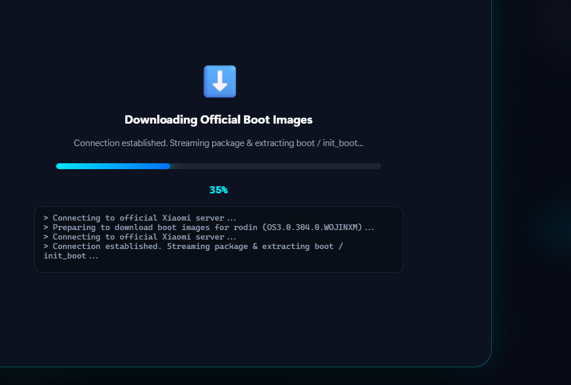
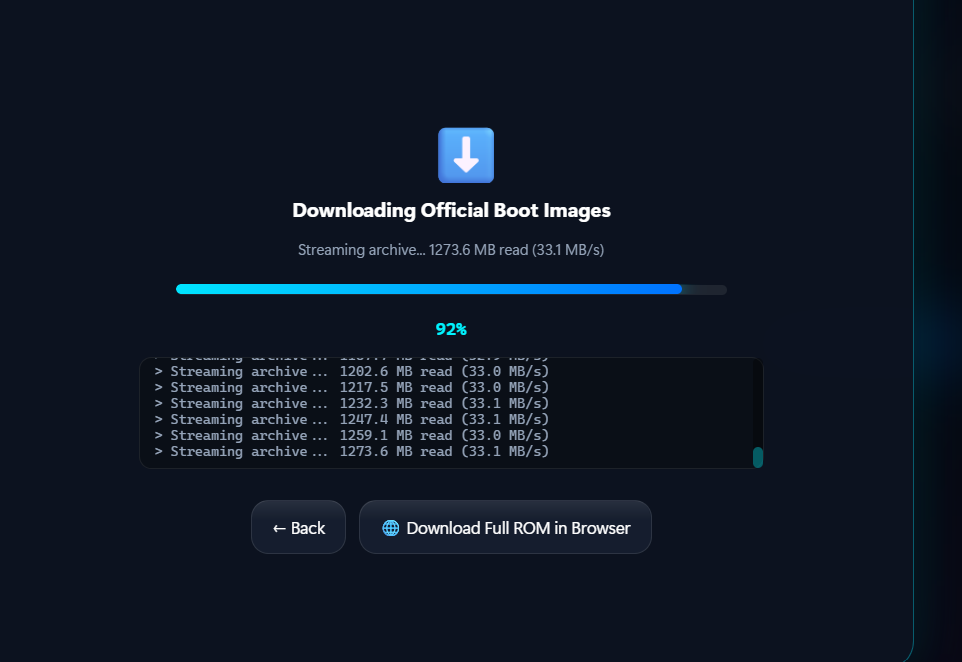
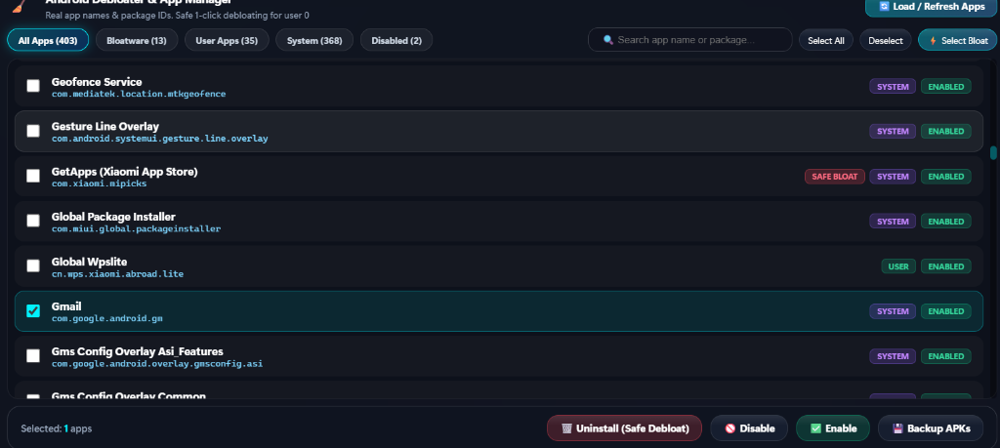
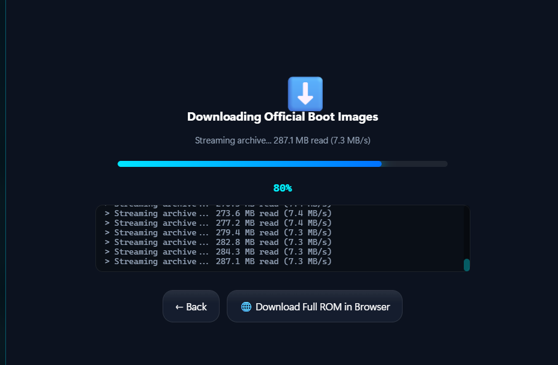

# ⚡ ROM Flasher Tool for PC (Windows)
### *The Ultimate Android Flashing, Debloating, and Recovery Suite with Apple Liquid Glass UI*

  <b>Flash Fastboot ROMs</b> • <b>Bypass Anti-Rollback (ARB) Brick Locks</b> • <b>AOSP Payload.bin Sideload</b> • <b>Single-Click Debloater</b> • <b>Full Game OBB Backup</b>

[📥 Download Latest .EXE](https://github.com/Rohit-Bhai-Youtube/ROM_Flasher_Tool_For_PC/releases/latest) • [📱 Phone-to-Phone Version (No PC)](https://github.com/Rohit-Bhai-Youtube/rom-flasher-tool) • [📺 YouTube Channel](https://youtube.com/@RohitBhai)

---

## 📱 PC नहीं है? कोई बात नहीं! फोन से भी कर सकते हैं! (No PC? Use Android-to-Android!)

> **💡 अगर आपके पास PC या Laptop नहीं है, तो आप अपने Android फोन से सीधे दूसरे फोन को USB-OTG केबल लगाकर फ़्लैश कर सकते हैं!**

मैंने इसी ROM Flasher Tool का एक **Android App Version** भी बनाया है, जो बिना PC और बिना Termux के, फोन-टू-फोन (USB-OTG) Fastboot ROMs, Custom ROMs, Root और Recovery को 1-क्लिक में फ़्लैश कर देता है:

👉 **[📱 Download ROM Flasher Tool for Android (No PC / USB-OTG)](https://github.com/Rohit-Bhai-Youtube/rom-flasher-tool)**

---

## 📸 Screenshots & UI Showcase

### 1. ⚡ 1-Click Fastboot Auto Flasher & Real-Time Apple HUD
*Automated Anti-Rollback (ARB) bypass, real-time battery thermal HUD, BrickShield codename verification, and live fastboot log terminal.*

---

### 2. 🎯 Individual Partition Flasher & Recovery ADB Sideload
*Apple Liquid Glass selector for `boot`, `init_boot`, `recovery`, `vbmeta` (AVB Disable), `vendor_boot`, and direct OTA sideloading.*

---

### 3. 🛡️ Universal Android Debloater & 1-Click Game Backup Engine
*Safe User 0 debloat with HyperOS/MIUI SecurityException bypass. Backs up Split APKs + Full Game OBB expansion files + Media storage with 1-click restore script.*

---

### 4. 📥 Official Xiaomi / HyperOS Firmware Hub
*Search and download official Fastboot (.tgz) and Recovery (.zip) ROMs directly from official high-speed CDNs with integrated 1-click boot image extractor.*

---

## 🚀 Key Features

* **🍏 Apple Liquid Glass Dark UI:** High-performance frosted glass design with dynamic neon glows and responsive device connection vitals.
* **⚡ 1-Click Auto Flasher:**
  * Auto-detects Xiaomi/POCO Fastboot TGZ/ZIP scripts and AOSP `payload.bin`.
  * **Anti-Rollback (ARB) Bypass:** Prevents hard bricks during downgrade or cross-region flashing.
  * Automatic payload.bin boot image extraction & sideloading.
* **🎯 Individual Partition Flasher:**
  * Flash specific partitions directly: `boot`, `init_boot`, `recovery` (TWRP/OrangeFox), `vbmeta` (with automatic AVB/DM-Verity disable option), `vendor_boot`, `dtbo`, and `super`.
* **🛡️ Universal Android Debloater & App Manager:**
  * Real app name resolution for hundreds of system and bloatware packages.
  * **HyperOS / MIUI Bypass:** Freezes and uninstalls bloatware safely for User 0 even when standard ADB debugging restrictions exist.
  * Single-click per-app actions: `🗑️ Uninstall`, `🚫 Disable`, `✅ Enable`, and `💾 Backup`.
* **💾 Complete App & Game Backup Engine (Zero-Gimmick):**
  * Backs up all Split APKs (`base.apk`, `split_config.*.apk`).
  * Backs up full Game OBB data (`/sdcard/Android/obb/<pkg>/`).
  * Backs up Media storage (`/sdcard/Android/media/<pkg>/`) and external app data.
  * Generates an automatic 1-click `Restore_App_And_Data.bat` script inside each backup folder for zero-touch offline restoration.
* **📥 Official Firmware Hub:**
  * Live search and 1-click high-speed CDN downloads for Xiaomi, POCO, Redmi (Fastboot & Recovery ROMs).
  * Instant Boot Image Extractor for rooting.
* **🧪 Root Studio:**
  * Magisk, KernelSU, and APatch root integration.
* **🔌 Universal Driver Assistant:**
  * Automatic WinUSB, Google Android Bootloader, MTK, and Qualcomm 9008 driver validation and installer.

---

## 📥 Download Standalone Tool (.EXE)

Zero installation required. Download the pre-built `.exe` file and run it on Windows:

👉 **[⬇️ Download Latest ROM Flasher Tool for PC (.exe)](https://github.com/Rohit-Bhai-Youtube/ROM_Flasher_Tool_For_PC/releases/latest)**

---

## 📺 Follow Rohit Bhai on YouTube!

For step-by-step video tutorials, custom ROM reviews, rooting guides, and unbricking tutorials, make sure to subscribe to the official YouTube channel:

* **📺 YouTube Channel:** [Rohit Bhai (@RohitBhai)](https://youtube.com/@RohitBhai)
* **🌐 Official Website:** [romflasher.in](https://romflasher.in) — *180+ step-by-step flashing guides, custom recoveries, and rooting tutorials.*
* **📱 Android-to-Android OTG Flasher:** [ROM Flasher Tool for Android](https://github.com/Rohit-Bhai-Youtube/rom-flasher-tool)

---

## ⚖️ License & Disclaimer

This tool is created for educational and recovery purposes. Always backup your personal data before flashing any device.  
Developed with ❤️ by **Rohit Bhai**.
